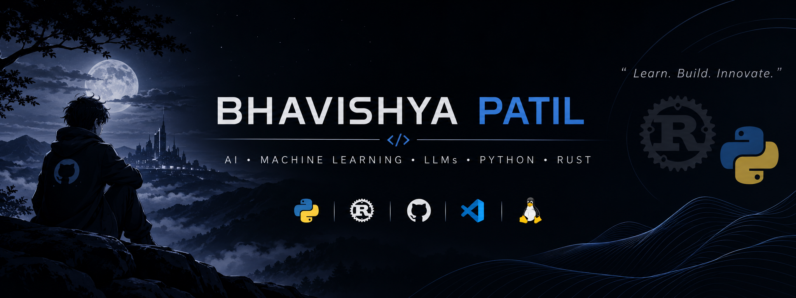

  

 
Bhavishya Patil

Student Developer | Aspiring AI/ML Engineer

Exploring the world of software engineering, Artificial Intelligence, Machine Learning and Large Language Models.

I believe in understanding how technology works from the ground up — not just using tools, but learning to build them.

---

About Me

- Currently a student and aspiring software engineer.
- Learning Python and Rust.
- Exploring Artificial Intelligence, Machine Learning and LLM engineering.
- Interested in building APIs, developer tools and intelligent systems.
- Focused on learning through practical projects and experimentation.

Technical Interests

Area| Focus
Programming| Python, Rust
Artificial Intelligence| AI and Machine Learning
Language Models| LLMs and Transformers
Software Engineering| OOP, Data Structures and Algorithms
Backend Development| APIs and System Design

Technologies & Tools

  

Current Focus

- Strengthening Python fundamentals.
- Learning Rust and its ownership system.
- Understanding Data Structures and Algorithms.
- Exploring ML mathematics and fundamentals.
- Building practical software projects.

Projects

I use projects to turn concepts into practical experience.

Featured projects will be added here as they develop.

---

My Philosophy

«Learn the fundamentals. Build from scratch. Improve through experimentation.»

I am at the beginning of my journey, and this profile will grow alongside my skills and projects.

---

  <b>BUILD • LEARN • EXPERIMENT • REPEAT</b>
   
  Bhavishya Patil | Student Developer

